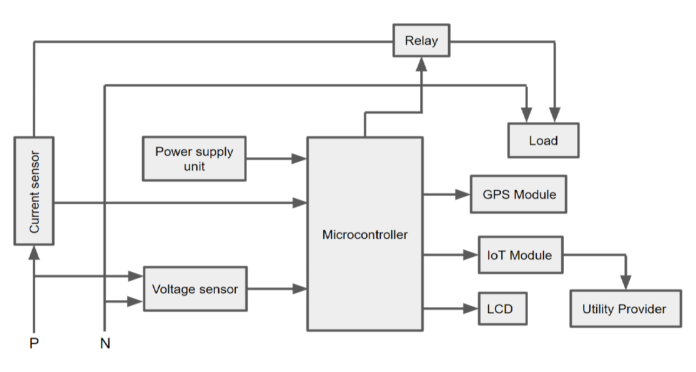
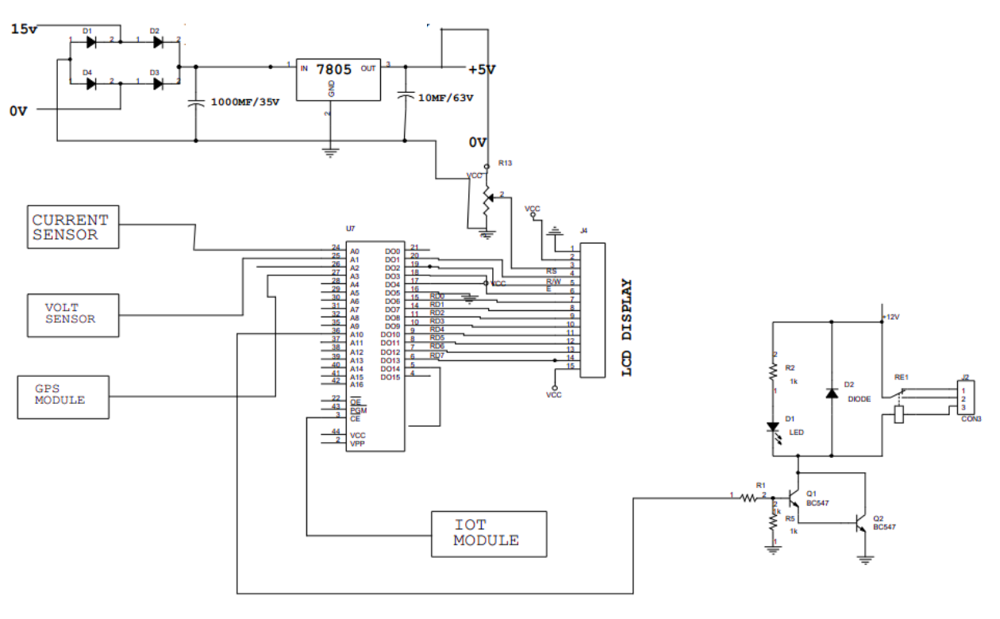
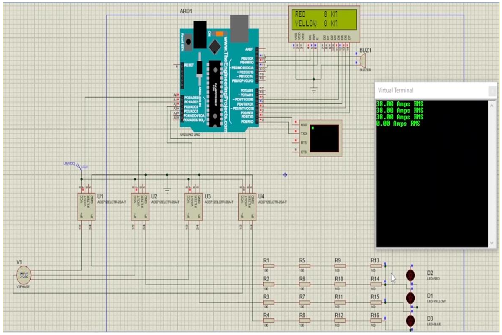
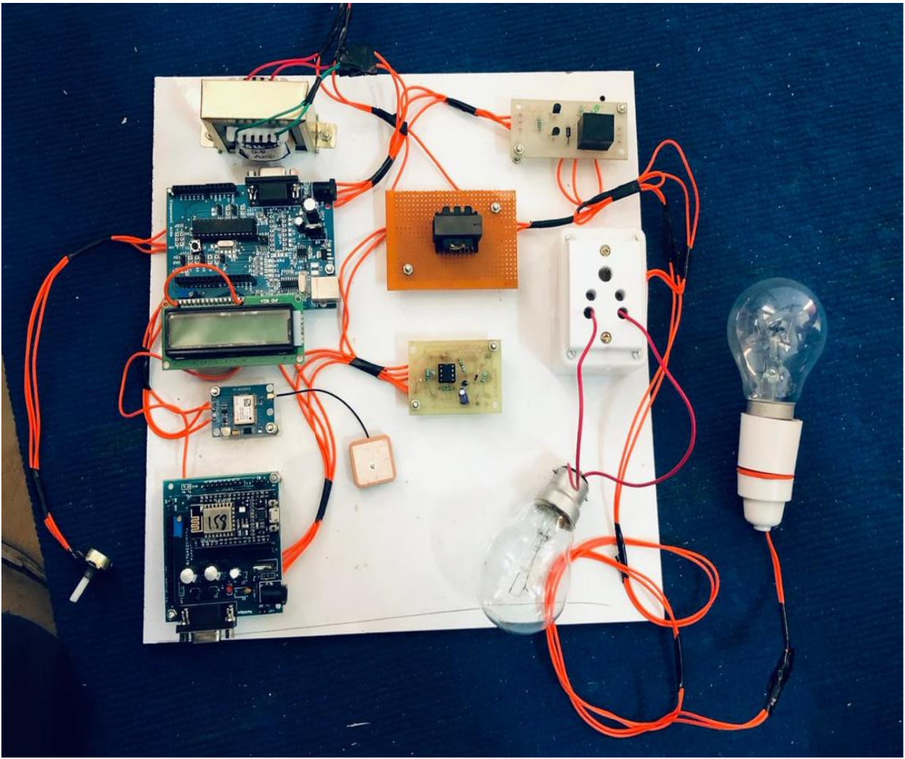

# Automatic Fault Detection and Location in Distribution Lines using IoT

**B.Tech Project | Electrical and Electronics Engineering | KMEA Engineering College, Edathala (APJ Abdul Kalam Technological University) | May 2023**
An Arduino-based laboratory prototype for detecting faults in a distribution line, identifying the affected phase and estimating the fault distance. The system displays fault information on an LCD, disconnects the load through a relay, and incorporates GSM, Wi-Fi-based IoT and GPS modules for communication and location information.

> **Scope note:** This was a laboratory prototype. The line is modelled with a set of resistors that represent cable length in km, and faults are created manually with switches. The project was also simulated in Proteus 8. The report describes the working of the system but does not give a quantitative accuracy analysis of the distance estimate.

## Project team

- Adhil Abdul Jabbar
- Ahammed Alsaj D A
- Anjana Mahendran

**Supervisor:** Ms. Neenu B

## Problem

Faults on the low-tension side of distribution lines are usually found by inspection, which is slow. This project builds a low-cost system that finds a fault automatically, reports where it is and which phase is affected, and alerts the electricity provider so that the repair crew can reach it sooner.

## How it works

1. Current and voltage sensors (a current transformer and a potential transformer, with precision-rectifier signal conditioning) measure each phase and the neutral.
2. The Arduino Uno reads the signals through its ADC and compares them with the normal condition.
3. When a fault is detected, the Arduino works out which fault it is. The distance is estimated from the voltage and current using an impedance-based method.
4. The LCD (16x2) shows the faulted phase and the distance in km.
5. A relay disconnects the load from the faulted line.
6. The GSM module (SIM900-type) and ESP8266/NodeMCU provide communication functions for transmitting fault information. The GPS module provides location data associated with the fault.

The system is limited to line-to-line and line-to-ground faults in overhead distribution lines.

## Block diagram

## Circuit diagram

## Hardware

| Part | Use |
| ---- | --- |
| Arduino Uno (ATmega328P) | Reads the sensors, detects and classifies the fault, drives the LCD and relay |
| Current sensor and voltage sensor | Measure line current and voltage |
| Precision rectifier (TL082 op-amp) | Conditions the CT and PT signals for the ADC |
| Step-down transformer, bridge rectifier, 7805 regulator | 5 V power supply |
| Relay module | Cuts off the load on a fault |
| 16x2 LCD | Shows the faulted phase and distance |
| GSM module (SIM900-type) | Sends fault information through GSM communication |
| NodeMCU (ESP8266) | Provides Wi-Fi-based IoT communication |
| GPS module | Provides location data |
| Buzzer | Alerts people near the fault |

## Simulation

The system was simulated in Proteus 8 Professional, and the microcontroller was programmed with the Arduino IDE. The supply is a three-phase AC source. A current sensor is placed in each phase and in the neutral line, the line resistance is modelled with resistors, and the load is three LED bulbs. The LCD shows the faulted phase and the distance in km.

## Hardware prototype

The simulation parameters were used to build a laboratory prototype. Cable length is represented by a set of resistors, and faults are created with switches at known distances so that the displayed distance can be checked.

## Advantages

- Helps linemen find the fault location quickly.
- Reduces the time to restore supply.
- Keeps a record of faults using IoT.
- Uses few components, so it is low cost.
- Uses wireless communication.

## Limitations

- Laboratory prototype only; it was not tested on a real distribution line.
- Faults were created manually with switches on a resistor model of the line.
- The report does not give measured accuracy figures for the distance estimate.
- Only line-to-line and line-to-ground faults are covered.

## Future work

- More accurate sensors.
- Machine learning for fault detection and classification.
- Fusing data from sensors, weather stations and SCADA.
- Predictive maintenance models.
- Better fault localization algorithms.

## Tools

Arduino IDE, Proteus 8 Professional, Arduino Uno, Node MCU (ESP8266), GSM module, GPS module.

## Author of this repository

Anjana Mahendran, M.Tech Instrumentation & Control Engineering, CUSAT

